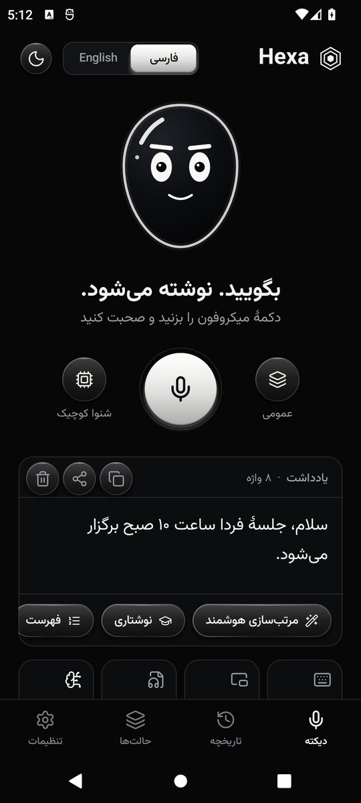
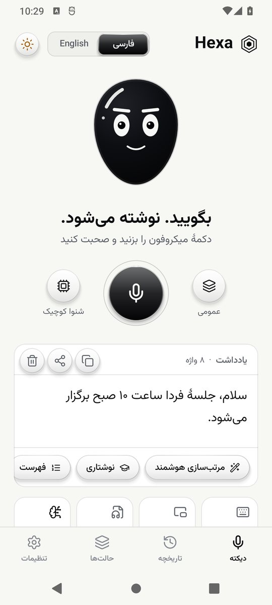
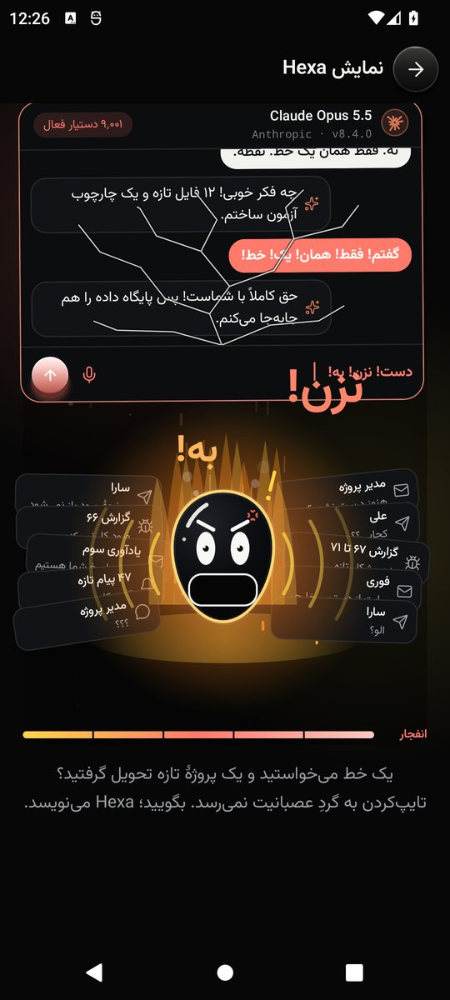
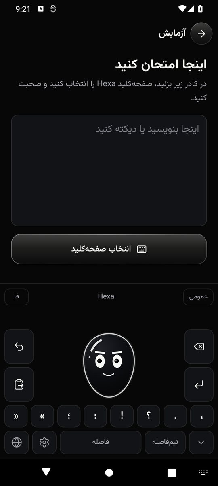

# Hexa

**بگویید. نوشته می‌شود.** دیکتهٔ صوتی فارسی برای اندروید که کاملاً روی خود گوشی کار می‌کند؛ بدون اینترنت، بدون حساب کاربری.

<a href="https://github.com/hydryanamyrly33-rgb/hexa/releases/latest/download/Hexa.apk"><b>دریافت Hexa برای اندروید</b></a>
 · <a href="https://hexa-fa.vercel.app">وب‌سایت</a>
 · <a href="https://t.me/Mr_CaceRo">پشتیبانی در تلگرام</a>

> مخصوص ایرانیان، با عشق، رایگان عرضه می‌شود. اما شما هم حمایت کنید: به این مخزن ستاره بدهید.
> برنامه در اولین اجرا نام کاربری گیت‌هاب شما را می‌پرسد و ستاره را بررسی می‌کند.

## چه می‌کند

- **دیکتهٔ فارسی آفلاین**؛ صدا از گوشی بیرون نمی‌رود.
- **نوشتن در همهٔ برنامه‌ها** با صفحه‌کلید Hexa یا سر شناور؛ متن مستقیم در کادر پیام می‌نشیند.
- **تشخیص فضا**: برای پیام‌رسان، ایمیل، جست‌وجو، یادداشت و گفت‌وگو با هوش مصنوعی خودش را آماده می‌کند.
- **سه پروفایل مدل**: سریع، متعادل، دقیق؛ به‌همراه انگلیسی و مدل‌های چندزبانهٔ اختیاری.
- **تبدیل فایل صوتی به متن**، متن زنده هنگام صحبت و توقف خودکار با سکوت.
- **نگارش فارسی**: نیم‌فاصله، رقم‌ها، علائم گفتاری، حالت‌های نگارش و واژگان شخصی.
- **تم شب و روز**، چند پالت رنگ، دکمه‌های شیشه‌ای و شخصیتی که انگشت شما را دنبال می‌کند.
- به‌روزرسانی درون‌برنامه‌ای؛ نسخهٔ تازه روی نسخهٔ قبلی نصب می‌شود.

## نصب

1. به این مخزن ستاره بدهید (دکمهٔ Star بالای صفحه).
2. فایل `Hexa.apk` را از پیوند بالا دریافت و نصب کنید؛ مدل‌های اصلی درون آن است.
3. برنامه را باز کنید، نام کاربری گیت‌هاب خود را وارد کنید و «راه‌اندازی» را دنبال کنید.
4. در گوشی‌های شیائومی «راهنمای شیائومی و MIUI» را در تنظیمات برنامه ببینید.

اندروید ۸ یا بالاتر. `Hexa-lite.apk` نسخهٔ کم‌حجم است و مدل‌ها را پس از نصب دریافت می‌کند.

## پشتیبانی و گزارش مشکل

تلگرام: [@Mr_CaceRo](https://t.me/Mr_CaceRo)

## حقوق

**سازنده: amirali_ktp** · تلگرام [@Mr_CaceRo](https://t.me/Mr_CaceRo)

Hexa نرم‌افزاری اختصاصی است و متن‌باز نیست. **هرگونه کپی، بازنشر، تغییر، مهندسی معکوس و استفاده از کد، طراحی، نام و شخصیت Hexa بدون اجازهٔ کتبی سازنده ممنوع است.** استفادهٔ شخصی از نسخهٔ رسمی رایگان است. متن کامل در [LICENSE](LICENSE) و مجوز اجزای شخص ثالث در [NOTICE](NOTICE).

© 2026 amirali_ktp — All rights reserved. Copying or redistribution is prohibited.

